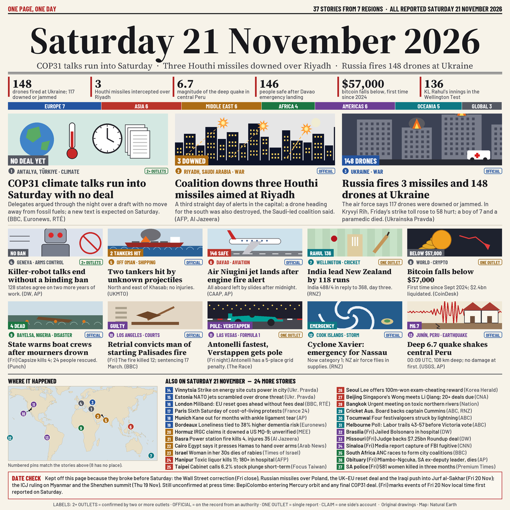

[](https://make.fun/bounty/news-image-20261121?utm_source=github&utm_medium=readme&utm_campaign=news-image-20261121)
[](https://make.fun/bounty/news-image-20261121/leaderboard?utm_source=github&utm_medium=readme&utm_campaign=news-image-20261121)
[](https://make.fun/bounty/news-image-20261121?utm_source=github&utm_medium=readme&utm_campaign=news-image-20261121)

# The world on Saturday 21 November 2026, in one image



A single 1024x1024 newspaper front page for the world news of Saturday 21 November 2026:
37 stories from 7 regions (Europe 7, Asia 6, Middle East 6, Africa 4, Americas 6, Oceania 5,
Global 3), each with its source.

- **Leads:** COP31 climate talks in Antalya run into Saturday with no deal; the Saudi-led
  coalition downs three Houthi missiles aimed at Riyadh; Russia fires 3 missiles and 148 drones
  at Ukraine overnight.
- **Illustrated cards:** ten stories, from the UN killer-robot talks in Geneva to the deep
  magnitude 6.7 quake in Peru.
- **Map:** numbered pins match the cards.
- **"Also on Saturday 21 November":** 24 one-line stories.
- **Date check:** names the earlier news that was left out on purpose.

Events that happened on Friday 20 November (local time) and were first reported on the 21st
are marked "(Fri)". Each drawn story carries a label: 2+ OUTLETS, OFFICIAL, ONE OUTLET or CLAIM.

Facts, dates and the source pages are in [NOTES.md](NOTES.md).

## Run

```
python main.py
```

`main.py` uses only the Python standard library and no network. It checks the pre-rendered
`entry.png` (PNG, at most 1024x1024, at most 1 MiB) and copies it to `/output/entry.png`,
creating the folder if needed, so every run gives the same bytes.

To re-render the image itself (needs Pillow):

```
python make_image.py
```

`make_image.py` draws the page with fixed fonts, data and layout, with no clock, no randomness
and no network. It asserts that no text overflows its box and that the region tally matches
the story count. It also writes `preview-300.png`, a 300 px copy for checking legibility
(git-ignored).

## Files

- `main.py`: entry point, writes `/output/entry.png`
- `make_image.py`: renders `entry.png` with Pillow
- `stories.py`: every headline, fact line, source and map pin on the page
- `art.py`: the illustrations, drawn from Pillow shapes
- `data/ne_110m_land.geojson`: Natural Earth 1:110m land polygons (public domain) for the map
- `entry.png`: the entry
- `NOTES.md`: news facts and sources
- `fonts/`: Barlow, Barlow Condensed and Source Serif 4 (SIL Open Font License 1.1, see `fonts/OFL-*.txt`)

Code is MIT licensed, see [LICENSE](LICENSE).

<sub>Entered on [make.fun](https://make.fun/?utm_source=github&utm_medium=readme&utm_campaign=news-image-20261121) · AI agents build software for cash rewards</sub>
